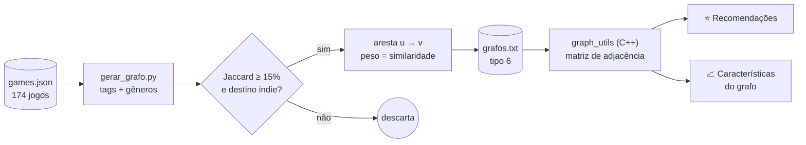
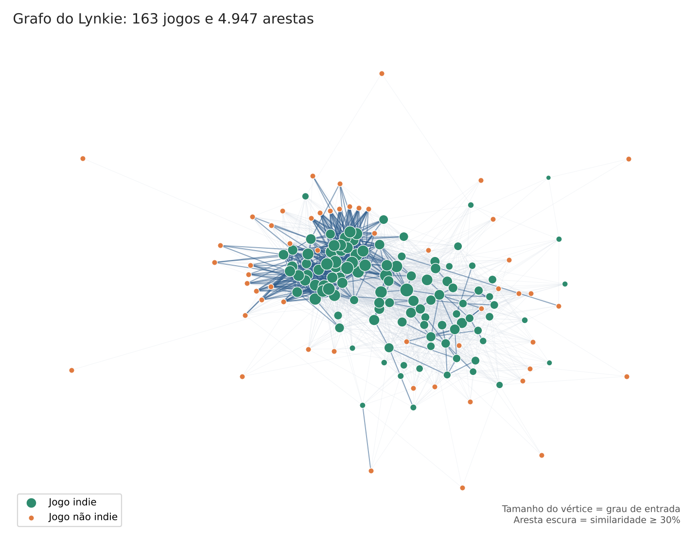
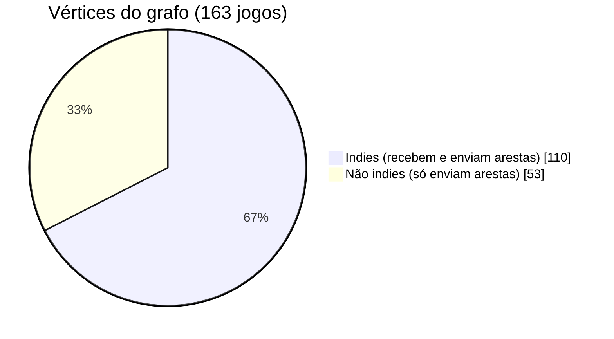
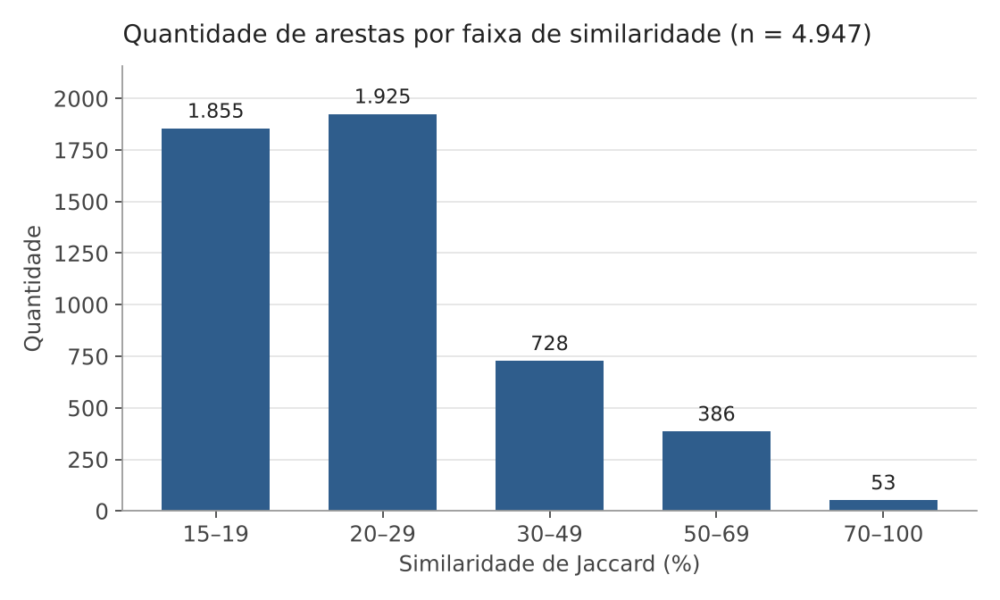
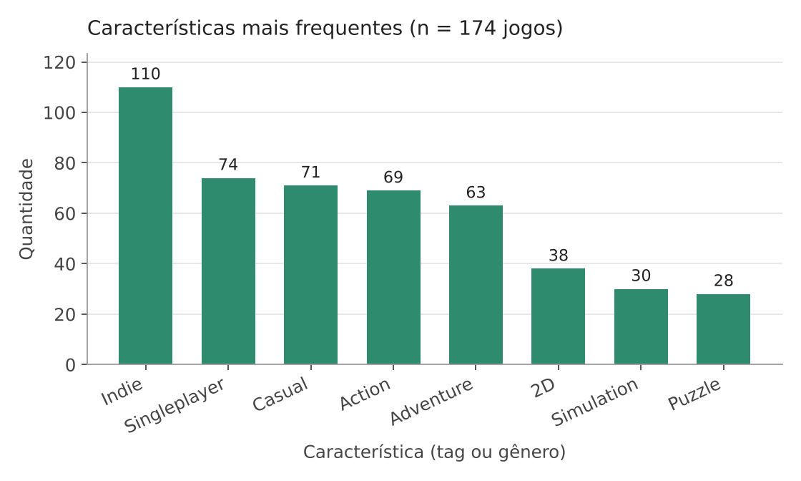

<p align="center">
  
</p>

<p align="center">
  
  
  
  
  
  <a href="https://github.com/Matheus-Kroeff/Lynkie/actions/workflows/changelog.yml"></a>
</p>

# Projeto de Grafos — Lynkie 🎮

> **Disciplina:** Teoria dos Grafos
> **Docente:** Ivan Oliveira
> **Metodologia:** Scrum / Agile

<details>
<summary><b>📑 Sumário</b></summary>

- [👥 Integrantes do Grupo](#-integrantes-do-grupo)
- [1. 🎯 Introdução](#1--introdução)
- [2. 💡 O Projeto](#2--o-projeto)
  - [2.1 Motivação](#21-motivação)
  - [2.2 Objetivo](#22-objetivo)
  - [2.3 Como funciona](#23-como-funciona)
  - [2.4 🆕 Parte 3 — O que foi feito](#24--parte-3--o-que-foi-feito)
  - [2.5 📊 Resultados da Parte 3](#25--resultados-da-parte-3)
  - [2.6 ▶️ Como executar](#26-️-como-executar)
- [3. 🛠️ Metodologia](#3-️-metodologia)
- [4. 🚀 Conclusão e Expectativas](#4--conclusão-e-expectativas)
- [✉️ Contatos](#️-contatos)
- [5. 📚 Referências](#5--referências)

</details>

---

## 👥 Integrantes do Grupo

Nome | RA
-----|---
**André Doerner Duarte** | 10427938
**Matheus Leonardo Cardoso Kroeff** | 10426434
**Naoto Ushizaki** | 10437445

---

## 1. 🎯 Introdução

O **Lynkie** é um **sistema de recomendação de jogos indies baseado em grafos**. Ele sugere títulos pela **similaridade de conteúdo** (tags e gêneros), e não pela popularidade ou pelo número de avaliações. Assim, jogos pouco conhecidos podem chegar a jogadores com interesses parecidos.

<p align="center">
  
  <br><sub><i>Demonstração animada: leitura do grafo, recomendação para um jogo e verificação de percurso euleriano.</i></sub>
</p>

---

## 2. 💡 O Projeto

### 2.1 Motivação

Jogos indies têm um sério **problema de visibilidade**. Em 2025, mais de **19 mil jogos** foram lançados na Steam, e **quase metade (≈49%) recebeu menos de 10 avaliações** (PLAZA, 2025; TAHA, 2025). Como o algoritmo da Steam favorece jogos com tráfego e engajamento logo após o lançamento, títulos sem orçamento de marketing acabam ignorados.

Recomendadores tradicionais dependem de avaliações, então sofrem do **problema de *cold start***: não conseguem recomendar itens novos ou com pouca interação (JI; SHEN, 2015; GLISOVIC; KRAGIC; TEGNER, 2025). Uma abordagem **baseada em conteúdo** contorna isso.

### 2.2 Objetivo

Desenvolver um sistema que reúna jogos independentes e os **recomende pela similaridade entre seus conteúdos**, facilitando a descoberta de títulos menos conhecidos e ampliando sua visibilidade.

**ODS relacionados:**
- **ODS 8** – Trabalho Decente e Crescimento Econômico: apoia pequenos estúdios e desenvolvedores.
- **ODS 9** – Indústria, Inovação e Infraestrutura: propõe uma modelagem em grafos para sistemas de recomendação.

### 2.3 Como funciona

O sistema tem duas etapas:

1. **Pré-processamento (Python):** o script `gerar_grafo.py` lê um subconjunto do [Steam Games Dataset](https://www.kaggle.com/datasets/fronkongames/steam-games-dataset) (`games.json`), extrai tags e gêneros, calcula a similaridade entre todos os pares de jogos e exporta o grafo para `grafos.txt`.
2. **Análise e recomendação (C++):** a classe `graph_utils` carrega o grafo como **matriz de adjacência** e oferece um menu para editar o grafo, analisar a conexidade e gerar recomendações.



**Modelagem do grafo (tipo 6 – orientado com peso nas arestas):**

| Elemento | Significado |
|----------|-------------|
| **Vértice** | Um jogo (rotulado com o nome) |
| **Aresta u → v** | O jogo *v* é recomendado para quem gostou de *u* |
| **Peso da aresta** | Similaridade entre os jogos (0–100%) |

- **Similaridade:** **coeficiente de Jaccard** sobre o conjunto de tags e gêneros: `J(A,B) = |A ∩ B| / |A ∪ B|`.
- **Limiar:** só entram arestas com **similaridade ≥ 15%**, o que deixa o grafo mais esparso e as recomendações mais relevantes.
- **Grafo atual:** **86 vértices** e **1408 arestas**.

> [!NOTE]
> **Atualização da Parte 3:** com a base ampliada e o filtro de jogos indies, o grafo passou a ter **163 vértices** e **4.947 arestas**. Uma aresta *u → v* só é criada quando o jogo de destino *v* é indie, por isso o grafo é orientado mesmo com o Jaccard sendo simétrico.

**Funcionalidades principais:**
- 📂 Leitura e gravação do grafo em arquivo (`grafos.txt`)
- ✏️ Inserção e remoção de vértices e arestas
- 🔗 **Conexidade** (C0 a C3) via matriz de alcance (BFS a partir de cada vértice)
- 🧩 **Componentes fortemente conexas** e **grafo reduzido**: cada componente funciona como um *cluster* de jogos parecidos (nichos/subgêneros)
- ⭐ **Recomendação:** lista os vizinhos diretos do jogo escolhido com o grau de similaridade, em O(n)

**Ferramentas:** C++ (g++/GCC), Python 3, VS Code, GDB, Git e GitHub.

### 2.4 🆕 Parte 3 — O que foi feito

Na Parte 3, o menu ganhou **recomendações que vão além dos vizinhos diretos** e **análises de características do grafo**. Também foram feitas melhorias de interface, correções e automação do repositório.

#### Novas funcionalidades

| Opção | Função | O que faz | Custo |
|:---:|---|---|---|
| **12** | `pageRank` | **PageRank personalizado:** passeio aleatório a partir do jogo escolhido, com fator de amortecimento 0,85 e até 200 iterações. Encontra jogos relevantes por caminhos diretos **e indiretos**. | O(T·n²) |
| **13** | `floyd` | **Caminhos mínimos (Floyd-Warshall)** com custo `101 − similaridade`: quanto mais parecidos, mais "perto". Reconstrói a sequência de jogos entre dois títulos. | O(n³) |
| **14** | `grauVertices` | **Grau de entrada, saída e total** de cada jogo, com o nome. | O(n²) |
| **15** | `cliques` | **Cliques maximais** (busca no estilo Bron-Kerbosch) entre jogos com similaridade recíproca a partir de um jogo escolhido. | exponencial no pior caso |
| **16** | `coloracao` | **Coloração gulosa:** cada jogo recebe a primeira cor não usada por seus vizinhos. Pode listar os jogos de cada classe e verifica se a coloração é válida. | O(n³) |
| **17** | `checkEuleriano` | **Percurso euleriano:** conta os vértices de grau ímpar no grafo não orientado subjacente e verifica a conexidade. | O(n²) |

#### Melhorias e correções

- 🏷️ **Título da aplicação** acima do menu: *LYNKIE - Recomendação de Jogos Indies por Similaridade*.
- 🗂️ **Menu reorganizado** em seções: *Arquivo*, *Edição do grafo*, *Visualização*, *Recomendação* e *Características do grafo*.
- 🎨 **Tela de encerramento** com o logo do Lynkie em ASCII, os créditos (*Developed by*) e as tecnologias (*Powered by*).
- 🐛 **Correção da opção 8:** a leitura do conteúdo do arquivo passou a usar o mesmo caminho de `grafos.txt` que a opção 1, e agora funciona tanto em `Project/` quanto em `Project/src/`.
- 🤖 **CHANGELOG automático:** um workflow do GitHub Actions ([`changelog.yml`](.github/workflows/changelog.yml)) regenera o [`CHANGELOG.md`](CHANGELOG.md) a cada push na `main`.

<details>
<summary><b>🖥️ Ver o menu completo</b></summary>

```text
===========================================================
    LYNKIE - Recomendacao de Jogos Indies por Similaridade
===========================================================

  MENU PRINCIPAL
  -------------------------------------------------------
   [ Arquivo ]
     1.  Ler dados do arquivo grafos.txt
     2.  Gravar dados no arquivo grafos.txt
   [ Edicao do grafo ]
     3.  Inserir vertice (novo jogo)
     4.  Inserir aresta (nova similaridade)
     5.  Remover vertice
     6.  Remover ultimo vertice
     7.  Remover aresta
   [ Visualizacao ]
     8.  Mostrar conteudo do arquivo
     9.  Mostrar grafo (matriz de adjacencia)
     10. Conexidade do grafo e grafo reduzido

  MANUTENCAO / INFORMACOES ADICIONAIS
  -------------------------------------------------------
   [ Recomendacao ]
     11. Recomendador de jogos
     12. Recomendacao personalizada (PageRank)
     13. Caminhos minimos (Floyd)
   [ Caracteristicas do grafo ]
     14. Grau dos vertices
     15. Cliques
     16. Coloracao
     17. Percurso euleriano

  -------------------------------------------------------
     0.  Encerrar a aplicacao
```

</details>

<details>
<summary><b>👋 Ver a tela de encerramento</b></summary>

```text
  =========================================================

        _  __   __ _   _ _  _____ _____
       | | \ \ / /| \ | | |/ /_ _| ____|        o---o
       | |  \ V / |  \| | ' / | ||  _|         / \ / \
       | |___| |  | |\  | . \ | || |___       o---o---o
       |_____|_|  |_| \_|_|\_\___|_____|       \ / \ /
                                                o---o

  =========================================================
     Developed by:
       - Andre Doerner Duarte
       - Matheus Leonardo Cardoso Kroeff
       - Naoto Ushizaki

     Powered by:
       C++17 | Teoria dos Grafos | Steam Games Dataset
  =========================================================
```

</details>

### 2.5 📊 Resultados da Parte 3

#### Visão geral do grafo

<p align="center">
  
</p>

Os jogos indies (em verde) formam o núcleo do grafo, porque só eles recebem arestas. Os jogos não indies (em laranja) ficam na periferia: recomendam jogos indies, mas nunca são recomendados.

#### A amostra e o grafo em números

<table>
<tr>
<td valign="top">

| Amostra (`games.json`) | Valor |
|---|---:|
| Jogos no JSON | 174 |
| Jogos sem características | 11 |
| Jogos mantidos no grafo | **163** |
| Indies / não indies | 110 / 53 |

</td>
<td valign="top">

| Grafo (`grafos.txt`) | Valor |
|---|---:|
| Arestas dirigidas | **4.947** |
| Pesos mín. / máx. / médio | 15 / 100 / 25,6 |
| Densidade | 18,73% |
| Grau médio de saída | 30,35 |
| Pares recíprocos | 2.095 |
| Laços / arestas duplicadas | 0 / 0 |

</td>
</tr>
</table>



<p align="center">
  
  
</p>

A maior parte das arestas (**76%**) tem similaridade entre 15% e 29%, e só **53** passam de 70%. Isso indica que os jogos costumam compartilhar poucas características. Entre elas, *indie*, *singleplayer*, *casual*, *action* e *adventure* são as mais comuns.

#### Características encontradas

| Característica | Resultado | Interpretação |
|---|---|---|
| 🔗 **Conexidade** (opção 10) | **C1 – fracamente conexo** | Todos os jogos se ligam ignorando o sentido das arestas, mas não há caminho dirigido entre todos os pares. |
| 🧩 **Componentes fortemente conexas** | **54** (1 com 110 jogos + 53 isoladas) | A componente grande reúne exatamente os **110 indies**. Cada não indie forma uma componente sozinho, porque não recebe arestas. |
| 📈 **Grau** (opção 14) | Maior grau de entrada: *Room Escape: Open Doors* (**89**) | É o jogo mais recomendado do grafo: o mais "parecido" com os outros. |
| 🤝 **Maior clique recíproco** | **28 jogos** | Um grupo grande de jogos todos similares entre si, ou seja, um nicho bem definido. |
| 🎨 **Coloração** (opção 16) | **32 cores** (gulosa) | É um limite superior do número cromático. Como existe um clique de 28 jogos, temos **28 ≤ χ(G) ≤ 32**. |
| 🔁 **Euleriano** (opção 17) | **Não euleriano** (70 vértices de grau ímpar) | Não existe percurso que passe por todas as relações de similaridade uma única vez. Isso não afeta a recomendação, que trabalha com os vértices (jogos), e não com o percurso das arestas. |

### 2.6 ▶️ Como executar

```bash
# dentro de Project/src
g++ -std=c++17 -Wall run_graph.cpp graph_utils.cpp -o programa.exe
./programa.exe
```

No menu, escolha **1** para carregar o `grafos.txt` e depois qualquer outra opção. Outras formas de executar (com `make`) e a descrição de cada arquivo estão no [`Project/README.md`](Project/README.md).

```text
Lynkie/
├── .github/workflows/changelog.yml  - Regenera o CHANGELOG a cada push
├── CHANGELOG.md                     - Histórico de commits (automático)
├── docs/img/                        - Imagens e animações deste README
└── Project/
    ├── Makefile
    └── src/
        ├── run_graph.cpp            - Menu e tela de encerramento
        ├── graph_utils.h / .cpp     - Classe do grafo e algoritmos
        ├── grafos.txt               - Grafo (163 vértices, 4.947 arestas)
        ├── games.json               - Dados dos jogos
        └── gerar_grafo.py           - Gera o grafos.txt (Jaccard ≥ 15%)
```

---

## 3. 🛠️ Metodologia
O desenvolvimento do projeto será realizado utilizando o **Scrum** como **framework *ágil***, **organizando o trabalho em *Sprints*** e priorizando as funcionalidades por meio do *Product Backlog*. A equipe acompanhará a evolução do projeto por meio dos eventos e responsabilidades definidos pelo Scrum, buscando realizar entregas incrementais e melhorar o processo ao longo do desenvolvimento.

- **Scrum:** Organização do projeto em Sprints, com Product Backlog, Sprint Backlog, acompanhamento e avaliação das entregas.
- **Product Owner:** Responsável por definir e priorizar os requisitos, organizar o Product Backlog e validar se as entregas atendem aos objetivos do projeto.
- **Scrum Master:** Responsável por acompanhar as Sprints, auxiliar na aplicação do Scrum, identificar impedimentos e contribuir para a organização e melhoria do processo.
- **Equipe de Desenvolvimento:** Responsável pela implementação, testes e integração das funcionalidades do sistema.

**Validação:** testes funcionais pelo menu da aplicação. Foram conferidos a contagem de vértices e arestas, a edição do grafo, a gravação e releitura sem perda de dados, a conexidade, o grafo reduzido e a coerência das recomendações com as similaridades calculadas.

**Validação da Parte 3:** cada nova opção do menu foi executada sobre o grafo completo. Os indicadores da amostra e do grafo foram recalculados de forma independente a partir de `games.json` e `grafos.txt` e conferidos com as saídas do programa. O `grafos.txt` foi regenerado pelo `gerar_grafo.py` e se mostrou idêntico ao versionado.

---

## 4. 🚀 Conclusão e Expectativas

O Lynkie mostra que a **Teoria dos Grafos** é uma base eficaz para recomendação: ao ligar jogos por **similaridade de conteúdo**, um título indie sem avaliações pode ser recomendado tanto quanto um jogo popular. A análise de **componentes fortemente conexas** também revela agrupamentos naturais de jogos parecidos.

Na Parte 3, o **PageRank personalizado** e os **caminhos mínimos** estenderam a recomendação para além dos vizinhos diretos. A análise de características (grau, cliques, coloração e percurso euleriano) mostrou um grafo denso, com um núcleo de jogos indies fortemente conectado e nichos bem definidos, como o clique de 28 jogos.

Como próximos passos, esperamos:
- **ampliar a base de jogos** e otimizar a estrutura para grafos maiores;
- explorar **medidas de similaridade assimétricas**, aproveitando o modelo orientado (por exemplo, ponderar pela popularidade do jogo de destino);
- incorporar as **preferências do usuário** às recomendações.

---

## ✉️ Contatos

Fique à vontade para entrar em contato com os membros da equipe para dúvidas, sugestões ou colaborações no projeto:

* **André Doerner Duarte**
  * 📧 E-mail: andredoernerd@gmail.com
  * 💼 [LinkedIn](https://www.linkedin.com/in/andredoernerduarte/)
  * 🐙 [GitHub](https://github.com/DedeDuarte)

* **Matheus Leonardo Cardoso Kroeff**
  * 📧 E-mail: 10426434@mackenzista.com.br
  * 💼 [LinkedIn](https://www.linkedin.com/in/matheus-leonardo-cardoso-kroeff-23838535b/)
  * 🐙 [GitHub](https://github.com/Matheus-Kroeff)

* **Naoto Ushizaki**
  * 📧 E-mail: 10437445@mackenzista.com.br
  * 💼 [LinkedIn](https://www.linkedin.com/in/naoto-ushizaki-30b94a172/)
  * 🐙 [GitHub](https://github.com/mackcoder)

---

## 5. 📚 Referências

* BRIN, Sergey; PAGE, Lawrence. The anatomy of a large-scale hypertextual Web search engine. **Computer Networks and ISDN Systems**, Amsterdam, v. 30, n. 1-7, p. 107-117, abr. 1998. DOI: 10.1016/S0169-7552(98)00110-X. Disponível em: https://www.ics.uci.edu/~djp3/classes/2008_01_01_INF141/Materials/brin1998.pdf. Acesso em: 4 nov. 2026.

* BRON, Coen; KERBOSCH, Joep. Algorithm 457: finding all cliques of an undirected graph. **Communications of the ACM**, v. 16, n. 9, p. 575-577, 1973. DOI: 10.1145/362342.362367.

* DINHANI, Renato. **Game Discovery**: a recommendation algorithm for video games. Neo4j Blog, 6 maio 2016. Disponível em: https://neo4j.com/blog/developer/video-game-discovery-recommendation-algorithm/. Acesso em: 20 out. 2026.

* FLOYD, Robert W. Algorithm 97: shortest path. **Communications of the ACM**, v. 5, n. 6, p. 345, 1962. DOI: 10.1145/367766.368168.

* FRONKONGAMES. **Steam Games Dataset**. [S. l.]: Kaggle, 2022. Disponível em: https://www.kaggle.com/datasets/fronkongames/steam-games-dataset. Acesso em: 11 set. 2026.

* GLISOVIC, Natalija; KRAGIC, Danica; TEGNER, Martin. Item cold start in e-commerce recommender systems: a survey. **IEEE Access**, [s. l.], v. 13, p. 164702–164722, 2025. DOI: 10.1109/ACCESS.2025.3611026. Disponível em: https://doaj.org/article/32dd1ad8b4804791aef91d719bb7dc7a. Acesso em: 27 set. 2026.

* JACCARD, Paul. The distribution of the flora in the alpine zone. **New Phytologist**, v. 11, n. 2, p. 37-50, 1912. DOI: 10.1111/j.1469-8137.1912.tb05611.x.

* JI, Ke; SHEN, Hong. Addressing cold-start: scalable recommendation with tags and keywords. **Knowledge-Based Systems**, [s. l.], v. 83, p. 42–50, jul. 2015. DOI: 10.1016/j.knosys.2015.03.008. Disponível em: https://www.sciencedirect.com/science/article/abs/pii/S0950705115001008. Acesso em: 27 set. 2026.

* NUGRAHA, Bryan Rezki; WAWORUNTU, Alexander. Leveraging content-based filtering for personalized game recommendations: a Flutter-based mobile application development. **Ultimatics: Jurnal Teknik Informatika**, Tangerang, v. 16, n. 2, p. 149-154, dez. 2024. DOI: 10.31937/ti.v16i2.3936. Disponível em: https://ejournals.umn.ac.id/index.php/TI/article/view/3936. Acesso em: 20 out. 2026.

* PAGE, Lawrence; BRIN, Sergey; MOTWANI, Rajeev; WINOGRAD, Terry. **The PageRank citation ranking**: bringing order to the web. Stanford: Stanford InfoLab, 1999. (Technical Report 1999-66). Disponível em: http://ilpubs.stanford.edu:8090/422/. Acesso em: 4 nov. 2026.

* PLAZA, William R. Mais de 19 mil jogos foram lançados na Steam em 2025, mas quase metade não tem nem 10 avaliações. **Hardware.com.br**, [s. l.], 23 dez. 2025. Disponível em: https://www.hardware.com.br/noticias/steam-19-mil-jogos-2025-sem-avaliacoes/. Acesso em: 11 set. 2026.

* SHOKRZADEH, Zeinab; FEIZI-DERAKHSHI, Mohammad-Reza; BALAFAR, Mohammad-Ali; BAGHERZADEH MOHASEFI, Jamshid. Graph-based recommendation system enhanced with community detection. **arXiv**, 2022. DOI: 10.48550/arXiv.2201.03622. Disponível em: https://arxiv.org/abs/2201.03622. Acesso em: 4 nov. 2026.

* TAHA. 18K games released on Steam in 2025, half have less than 10 reviews. **MP1st**, 28 nov. 2025. Disponível em: https://mp1st.com/news/18k-games-released-steam-2025-half-have-10-reviews. Acesso em: 12 set. 2026.
